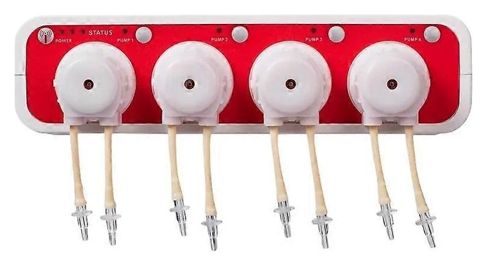

# Jebao Doser for Home Assistant — local, no cloud (HACS)

[](https://hacs.xyz/docs/faq/custom_repositories)
[](https://github.com/m0s4ik/ha-jebao-doser/releases)
[](https://github.com/m0s4ik/ha-jebao-doser/actions/workflows/validate.yml)
[](https://www.home-assistant.io/)
[](LICENSE)

<p align="center"><br><sub>Jebao DOSER 3.4 WiFi (product image © Jebao)</sub></p>

Home Assistant custom integration for **Jebao WiFi aquarium dosing pumps**: Jebao **DOSER 3.4** (tested) and other Gizwits based Jebao dosers (**DOSER 3.1**, **DOSER 3.2**, **MD 4.4**). It talks to the pump over the **local network** (local push), with no Jebao/Gizwits cloud and no account.

See in Home Assistant when each head doses, the dosing schedule (times, ml per day, interval in days), the last dose of every head and the pump alarms, and use them in automations: for example a notification if a scheduled dose did not run, or if the pump goes offline.

Built on the **[jebao-doser](https://github.com/m0s4ik/jebao-doser)** Python library (also usable on its own, from the command line).

## Supported pumps

| Model | Heads | Status |
|---|---|---|
| Jebao **DOSER 3.4** WiFi | 4 | ✅ tested (firmware 04X3000R) |
| Jebao **DOSER 3.1** / **DOSER 3.2** WiFi | 1 / 2 | should work (same Gizwits platform): reports welcome |
| Jebao **MD 4.4** | 4 | should work (same Gizwits platform): reports welcome |

Jebao DOSER 3.4 WiFi at a glance:

| | |
|---|---|
| Heads | 4 peristaltic heads |
| Flow | 50 ml/min per head |
| Power | 12 V, 9 W |
| Size | 226 × 84 × 61 mm |
| Tubing | 1.5 m |
| Connectivity | Wi-Fi 2.4 GHz + Bluetooth (ESP32-C3 module, Gizwits platform) |
| Local protocol | TCP 12416, UDP 12414 (discovery) |

## Entities

Per head (`N` = 1…4):

| Entity | |
|---|---|
| `binary_sensor` Head N dosing | the head is running right now |
| `sensor` Head N schedule | dose times; attribute `doses` = list of `{time, amount}` |
| `sensor` Head N amount per day | ml per dosing day |
| `sensor` Head N interval | days between dosing days |
| `sensor` Head N last dose | timestamp of the last dose, attribute `duration` (s); kept across restarts |
| `button` Head N dose | runs the head for its manual dose |
| `number` Head N manual dose | amount of the manual dose (ml), remembered |

Pump: local connection, power, open circuit alarm, Wi-Fi module fault. Translations: English, Italian.

Manual doses (from Home Assistant, the app or the buttons on the pump) are pushed by the pump the moment they happen. **Scheduled doses are not reported by the pump** (they run, but it does not say so): to be sure a dose ran, let Home Assistant start it (see below) or watch the power draw of the pump's plug.

## Dosing from Home Assistant

Press **Head N dose**, or use the action in automations:

```yaml
action: jebao_doser.dose
data:
  config_entry_id: <your pump>   # pick it in the UI editor
  head: 2
  ml: 4          # or: seconds: 5
```

The amount is turned into a run time with the flow set in the integration options (default 50 ml/min per head, the DOSER 3.4 spec: measure yours for accuracy). Home Assistant waits for the pump to confirm the head started (up to 3 s), otherwise it stops it and raises an error; the stop is always sent. Up to 120 s per dose. Writes change only the head being dosed, like the vendor app: schedules are not touched.

## Install

Home Assistant installs the [jebao-doser](https://pypi.org/project/jebao-doser/) library from PyPI by itself: nothing else to install.

**HACS**: *HACS → ⋮ → Custom repositories* → `https://github.com/m0s4ik/ha-jebao-doser`, category *Integration* → install → restart Home Assistant.

**Manual**: copy `custom_components/jebao_doser` into your `config/custom_components/` and restart.

Then *Settings → Devices & services → Add integration → **Jebao Doser (local)*** and enter the pump's IP address. Model and number of heads are read from the pump. Give the pump a fixed IP (DHCP reservation).

## ⚠️ Known limitation of the pump: scheduled doses are not reported

This is a behaviour of the **pump firmware**, not of this integration. Doses that run from the pump's **own schedule** (set in the Jebao app) are **not reported** by the pump at all: nothing on the local connection and nothing to the cloud (verified with packet captures, Jebao DOSER 3.4, firmware 04X3000R). So `Head N dosing` and `Head N last dose` only see doses started from Home Assistant, the app or the buttons on the pump.

If you want to be sure every dose runs, **schedule the doses in Home Assistant** with the `jebao_doser.dose` action instead of the pump's schedule: the pump confirms each dose, and you can be notified if it does not. Clear the pump's own schedule in the app to avoid double dosing (or keep it and accept that it is invisible).

```yaml
automation:
  - alias: "Doser: head 2, 4 ml every 2 days at 17:30"
    triggers:
      - trigger: time
        at: "17:30:00"
    conditions:
      - condition: template   # every other day
        value_template: "{{ (now().date() - as_datetime('2026-01-01').date()).days % 2 == 0 }}"
    actions:
      - action: jebao_doser.dose
        continue_on_error: true
        data:
          config_entry_id: <your pump>
          head: 2
          ml: 4
      - if: "{{ not is_state('sensor.jebao_doser_head_2_last_dose', 'unknown') and (now() - states('sensor.jebao_doser_head_2_last_dose') | as_datetime).total_seconds() > 120 }}"
        then:
          - action: notify.notify
            data:
              message: "Doser: head 2 did not dose at 17:30"
```

## Notes

- Editing the pump's own schedules is not exposed yet.
- The vendor app keeps working: the pump stays connected to its cloud.
- Security: anyone who can reach the pump on TCP 12416 can control it. Keep it on an isolated IoT network and allow that port only from Home Assistant.

The integration icon is the icon of the official Jebao Aqua app, used to identify the brand. Not affiliated with Jebao or Gizwits. MIT license.
